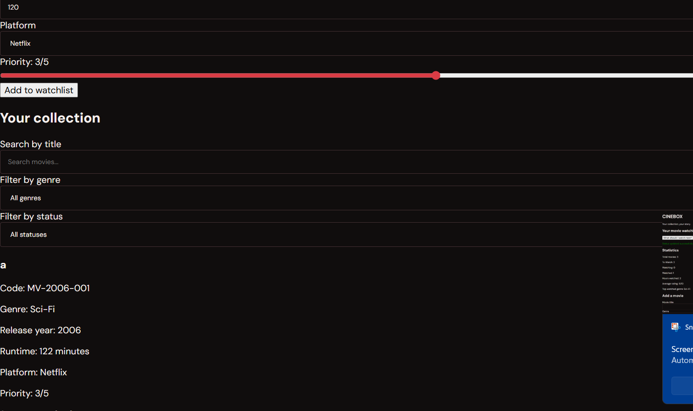
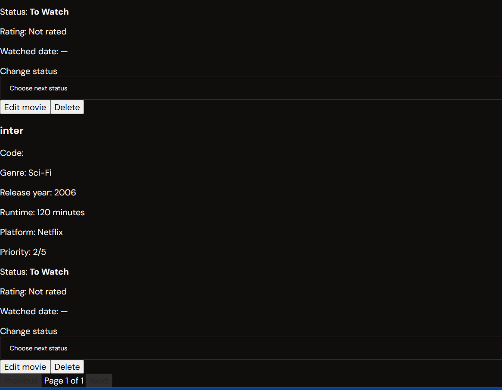

# Cinebox — Movie Watchlist Manager

A MERN Stack web application to organize movies, manage watch progress, rate watched movies, and decide what to watch next.

## Features

- Add movies with title, genre, release year, runtime, platform, and priority.
- Automatically generate unique movie codes based on release year.
- Track movie status: To Watch, Watching, and Watched.
- Rate watched movies from 1 to 10.
- Search movies by title and filter by status or genre.
- Paginate movie cards, displaying six movies per page.
- Get a Watch Next recommendation based on priority and runtime.
- View statistics, including movie counts, hours watched, average rating, and top watched genre.
- Edit movie details and delete movies when permitted.
- Validate inputs on both the frontend and backend.
- Store movie data in MongoDB Atlas.
- Responsive dark-red interface for desktop and mobile.

## Tech Stack

- **Frontend:** React, Vite, CSS, Axios, Lucide React
- **Backend:** Node.js, Express.js
- **Database:** MongoDB Atlas
- **ODM:** Mongoose

## Project Structure

```text
movie-watchlist-manager/
├── backend/
│   ├── .env
│   ├── Movie.js
│   ├── routes.js
│   ├── server.js
│   ├── package.json
│   └── package-lock.json
├── frontend/
│   ├── public/
│   ├── src/
│   │   ├── App.jsx
│   │   ├── App.css
│   │   ├── index.css
│   │   └── main.jsx
│   ├── package.json
│   └── vite.config.js
├── screenshots/
│   ├── homepage.png
│   └── movie-collection.png
└── README.md
```

## API Endpoints

All movie operations are handled through the Express backend.

| Method | Endpoint | Purpose |
|---|---|---|
| GET | `/api/movies` | List movies, search, filter, and paginate |
| POST | `/api/movies` | Add a movie |
| PUT | `/api/movies/:id` | Edit movie details |
| PATCH | `/api/movies/:id/status` | Change movie status |
| PATCH | `/api/movies/:id/rating` | Update a watched movie's rating |
| DELETE | `/api/movies/:id` | Delete a movie |
| GET | `/api/movies/watch-next` | Recommend the next movie |
| GET | `/api/movies/stats` | Retrieve dashboard statistics |

*Note: These endpoint paths should match the actual routes implemented in `backend/routes.js`.*

## Setup and Installation

### 1. Clone the repository

```bash
git clone https://github.com/alianysha/movie-watchlist-manager.git
cd movie-watchlist-manager
```

### 2. Set up the backend

```bash
cd backend
npm install
```

Configure `backend/.env` with your MongoDB Atlas test database connection:

```env
MONGO_URI=your_test_mongodb_atlas_uri
PORT=5000
```

Use valid test credentials in your local `.env` file.

Start the backend:

```bash
npm start
```

### 3. Set up the frontend

Open a **second terminal** in the project root and run:

```bash
cd frontend
npm install
npm run dev
```

Open the local URL displayed by Vite in your browser.

## Validation Rules

- Release year must be between 1950 and the current year.
- Runtime must be between 30 and 300 minutes.
- Movie titles and release years must be unique together, ignoring case.
- Movie codes are generated by the backend.
- Watched movies require a rating from 1 to 10 and an automatically recorded watched date.
- Watched movies cannot change status.
- Movies in Watching status cannot be deleted.
- To Watch movies are ordered by priority, highest first.

## Screenshots

### Homepage



### Movie Collection



## Repository

GitHub: https://github.com/alianysha/movie-watchlist-manager
## Movie Status Workflow

- **To Watch:** Movies waiting to be watched.
- **Watching:** Movies currently in progress.
- **Watched:** Completed movies with a required rating from 1 to 10.
- **Watch Next:** Recommends the highest-priority movie, using runtime as a tie-breaker.